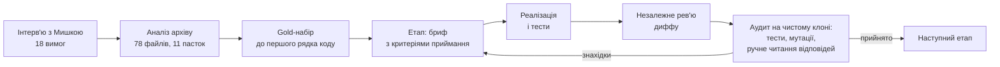

# Як створювався бот

Тут описано шлях від завдання до здачі: що робилося на кожному етапі, чому так і як перевірялося. Вимоги й технічні рішення докладно описані в [README](../README.md) та [architecture.md](architecture.md), а цей документ розповідає про послідовність і повороти. Замовниця на схемі нижче це Мишка-шкряботушка, бот у Telegram, з яким розробник провів інтерв'ю (докладніше в розділі "Контекст" у README).

## Підхід

Від початку до кінця трималися чотирьох правил:

1. Спершу вимоги, потім код. Інтерв'ю із замовницею закінчилося 18 погодженими пунктами з позначками, хто що вирішив: [М] означає Мишку, [Р] розробника. Нових вимог під час розробки не з'являлося.
2. Спершу еталон, потім пошук. До реалізації пошуку склали [gold-набір](gold-questions.md): 31 питання з очікуваною поведінкою, документами, цитатами й забороненими документами, плюс 14 кейсів лише для пошуку. Скрипт перевірив кожну цитату на буквальну присутність у документі.
3. Кожен етап має перевірювані критерії приймання: точні числа тестів, вивід команд і прогони, а не формулювання "має працювати".
4. Етап приймається лише після незалежного аудиту. Він складається зі свіжого клону, власного прогону тестів і мутаційних перевірок, коли код ламають навмисно, щоб переконатися, що тести це помітять. Відповіді моделі читають вручну, бо скрипт оцінює лише вид відповіді й джерела.

## Етапи

| Дата | Етап | Що зроблено | Ключове рішення |
|---|---|---|---|
| 28.10 | Завдання | Отримано тестове | немає |
| 29.10 | Вимоги | Інтерв'ю з ботом-замовницею, 18 вимог; аналіз архіву: 78 файлів, 19 сканів без тексту, 11 суперечностей | Карта лісу береться з документа, а не з коду; поради звірів надсилають лише файлами |
| 29–30.10 | 01 Каркас | Docker Compose (бот + PostgreSQL), схема БД, імпорт архіву з класифікацією | Сферу документа визначає вступне речення, а не назва файлу |
| 29–30.10 | 02 Пошук | Лематизація, визначення місця за Картою, BM25 за шарами, синоніми | Без ембедингів: BM25 + фільтр за місцем дає 45 з 45 кейсів |
| 30.10 | 03 Відповіді | Groq зі strict JSON-схемою, ліміти, пам'ять розмови | Джерела будує бот, а не модель |
| 31.10 | 03b Промпт | Виправлення за ручною перевіркою gold-прогону | Застереження обов'язкові; побіжна згадка це не порада |
| 31.10 | 04 Поради звірів | Ім'я, формати, "поганий зір", місце, заміна версій і Карти, перехід на "ви" | Місце нової поради визначають правила, а якщо не вийшло, то кнопки, без LLM |
| 31.10 | 05 Списки й підписки | `/docs`, `/my` з видаленням, підписки, вимога 8 | Конфлікт порад "Під вербою" визначає код, а не модель |
| 31.10 | 06 Фініш | Тексти за тестом з людиною, лише особисті чати, документація, повний gold-прогін | Перевірка "очима оцінювача" на свіжому клоні |
| 01.11 | Здача | Чек-лист у Telegram з двома акаунтами, публікація | немає |

## Повороти: що пішло не за планом і як виправили

### OCR плутає цифри

На фоні "береста" tesseract читав "350 кроків" як "850", а цифру 3 як кириличну "З". Для 19 сканів архіву зроблено вивірені вручну транскрипти, прив'язані до sha256 файлу. OCR лишився для нових сканів, а числа з них бот перепитує в звіра кнопками ("поганий зір").

### Назва файлу бреше про сферу

Документ "Броди і коли бобри відкривають греблю" звучить як порада для однієї рукавички, але у вступі сказано, що вона для всіх, хто біля річки. Тому сферу документа визначає вступне речення.

### Перший розбір pymorphy3 хибить

"Соснах" він розбирає як "сосни", а "дуба" як "дуба". Лемою стала множина нормальних форм з усіх розборів.

### Фрагменти губили факти

Вибір релевантних речень замість цілих документів відрізав ключові застереження. Тепер у контекст ідуть цілі документи в межах бюджету 6000 символів.

### Groq бронює ліміт наперед

Безкоштовний рівень дає 8K токенів за хвилину, і Groq резервує `prompt + max_completion_tokens` ще до відповіді. Стелю відповіді знижено до 512, бо найдовша реальна відповідь з міркуваннями займала 363 токени.

### Повні джерела ще не означають правильну відповідь

В одному з перших прогонів маршрут до дуба мав правильні джерела, але модель загубила застереження "тільки не в суботу". Відтоді зміст кожної відповіді gold-набору читали вручну, а не лише зведення скрипта.

### "Ти" не втрималося

На звертанні "ти" модель зісковзувала на "ви" в 7 відповідях з 15. Увесь бот перейшов на "ви", а тест ловить будь-яке "ти" в текстах бота.

### Вимогу 8 промпт не втримав

"Під вербою" належить і до листяного лісу, і до річки, а коли поради розходяться, бот не має вибирати сам. Три версії промпту й `reasoning_effort=medium` не завадили моделі писати "саме сухе листя слід використовувати". Тепер конфлікт визначає детерміністичний детектор, а модель лише заповнює окремий пункт для кожної частини. Вступ "поради різняться" і фразу "Оберіть ту, що підходить саме вашому місцю" пише бот. Прототип детектора двічі хибив, і обидві помилки виправили до реалізації:

- статут рукавички вигравав лише завдяки слову "верба", тож назви місць із запиту прибираються;
- перевірка теми замість релевантності пропускала правильну відповідь рукавички.

### Тест з людиною без контексту

Тестувальник зависнув на питанні "Замінити її?", бо було незрозуміло, що станеться після кожної кнопки. Тексти переписано так, щоб кожна кнопка називала свій наслідок і щоб було видно, що вибір можна скасувати.

### Бот відповідав у групах

Вимога 1 каже про особисті повідомлення. Тепер усі обробники стоять під одним фільтром особистих чатів, тож новий обробник автоматично теж приватний.

## Як перевірено

Кількість тестів зростала так: 408 після етапу 03b, потім 543, 630 і 677 перед здачею, 0 пропущених. Telegram і Groq у тестах замінено фейками, а база справжній PostgreSQL.

На кожному етапі код навмисно ламали в найризикованіших місцях (видалення з поверненням версії, сповіщення, детектор конфлікту, фільтр чатів). Мутація, яку тести пропустили, ставала новим тестом наступного етапу, а якщо ні, аудит пояснював, чому в неї не буває тригера.

Повний gold-прогін перед здачею по справжньому Groq дав вид відповіді 28 з 31 і обов'язкові джерела 26 з 31. Розбіжності розібрано вручну й описано в [README](../README.md#відомі-обмеження). У пошуку 45 з 45 кейсів пройшли без жодного документа з чужого місця.

Запуск "очима оцінювача" пройшов на свіжому клоні з `.env` з прикладу і однією командою. Збірка з нуля зайняла 1 хв 56 с, від старту до готовності минуло 23 с. Чек-листи кожного етапу в Telegram пройдено вручну, а підписки перевірено з двома акаунтами.
